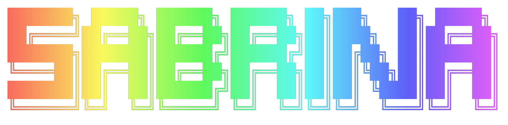

Welcome to my GitHub ✩°｡⋆⸜ 🎧✮

**Data & Software Engineer student · 42 Berlin · BA Data Science & Business Administration**

I build things end to end, from low-level C to data analysis to AI agents, and I care about the part most people skip: *where the numbers come from, and whether you can trust them.*

## Short profile (・ω・)

I combine three things:

- **Data**: a BA in Data Science & Business Administration: statistics, machine learning, regression and classification models.
- **Engineering**: project-based 42 Berlin curriculum, all in C on Unix: a shell, multithreading, a raycasting engine, memory and process management. 
- **Business**: business administration, an internship, and client work, so I think about what a result means for the people using it, not just whether the code runs.

**I'm looking for:** junior roles in **data / BI analytics, analytics engineering, or AI engineering** in Berlin, and **freelance projects** (websites and data dashboards for small businesses).

## What I bring (•̀ᴗ•́)و

- **Turning messy data into answers people trust**: cleaning, modelling, validating, and explaining results to non-technical people.
- **Building with AI critically**: I build agents and LLM tools, and I build ways to *check* them, like showing exactly what a model saw before it answered.
- **Real engineering habits**: Git, testing, debugging with Valgrind, code reviews (every 42 project is peer-evaluated).
- **Shipping**: deployed apps with real users, not just notebooks.
- **Communication**: I enjoy explaining technical work, and I've organised events and community activities at 42 Berlin.

## Selected projects ( •̀ ω •́ )✧

| Project | What it proves | Tech |
|---|---|---|
| **[localised-ai](https://github.com/sabrinapg/localised-ai)**: private AI agent running on your own computer | Built an **inspect mode** that shows, for every reply, what the AI saw, which memory it used or left out, and the model's raw output. Fixed model loading on Apple Silicon. *(Fork of a friend's project; my additions are listed in the repo.)* | Python, PyTorch, Hugging Face Transformers, Qwen, pytest |
| **[Cub3D](https://github.com/sabrinapg/Cub3D)**: 3D raycasting engine (team of 2) | The **maths of the raycaster (DDA algorithm)**: turning a 2D map into a 3D view in real time | C, MiniLibX, linear algebra |
| **[Blitz Fathersday](https://github.com/sabrinapg/blitz-fathersday)**: chess puzzle speed game | A deployed full-stack app: live puzzles from the Lichess API through an edge function, a leaderboard in Postgres | React, Vite, TypeScript, Tailwind, Supabase |
| **[Abalone Maturity](https://github.com/sabrinapg/Abalone-Maturity)**: predicting age from physical measurements | A full ML workflow: cleaning, resampling, comparing 10+ models (linear to gradient boosting), reporting | Python, scikit-learn, statsmodels, Jupyter |
| **Valgrinders**: hackathon coding agent ("Mai ist für AI 2026", 42 Berlin) | A multi-agent system: a planner, a coder and a reviewer model, with a local fallback | Python, Gemini, Groq, Aider, Ollama |

## 42 Berlin core curriculum (ง •̀ ᴗ •́)ง

- Completed: **Libft · ft_printf · get_next_line · Born2beroot · so_long · minitalk · push_swap · philosophers · minishell · Exam Rank 02 · Exam Rank 03 · Cub3D**
- In progress: **Exam Rank 04**, **NetPractice**, then the **C++ modules**

Additional Project Highlights:
- **minishell**: a Bash-like shell: lexer, parser, pipes, redirections, heredocs, signals, built-ins, zero memory leaks.
- **philosophers**: the dining philosophers problem with threads and mutexes, deadlock-free.

## Experience (￣▽￣)

- **Freelance**: web projects for clients, including a full-stack website for an employment agency.
- **Legal Intern** (Brunei)
- **Hospitality** (Berlin): fast-paced, customer-facing work.

## Education φ(．．)

- **B.A. Data Science & Business Administration**, Whitecliffe University, 2025 
- Earlier studies at James Cook University, Singapore
- **42 Berlin**, software engineering (peer-to-peer, project-based)

## Tech stack (⌐■-■)

**Data** 

**AI** 

**Engineering** 

**Web** 

**Tools** 

**Languages:** English (fluent) · German (learning, intermediate)

*Currently learning: SQL for analytics, dbt, and preparing an SAP data certification.* (ﾉ◕ヮ◕)ﾉ
